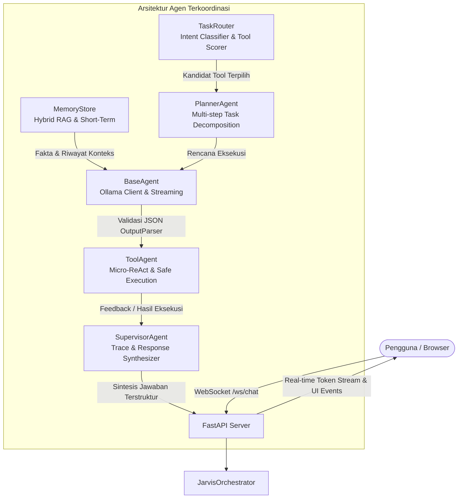

# 🤖 JARVIS AI Agent v2.0
> **Just A Rather Very Intelligent System** — Asisten AI Otonom Lokal Berbasis Python 3.11, Ollama, FastAPI, Multi-Agent Graph, dan In-Memory Hybrid RAG.

[](https://www.python.org/)
[](https://fastapi.tiangolo.com/)
[](https://ollama.ai/)
[](https://docs.pydantic.dev/)
[](https://tailwindcss.com/)
[](LICENSE)

---

## 📑 Daftar Isi
1. [Tentang Proyek](#-tentang-proyek)
2. [Arsitektur Sistem Multi-Agent](#-arsitektur-sistem-multi-agent)
3. [Fitur-Fitur Unggulan](#-fitur-fitur-unggulan)
4. [Daftar Lengkap 34 Tools Konsolidasi](#-daftar-lengkap-34-tools-konsolidasi)
5. [Struktur Direktori Repositori](#-struktur-direktori-repositori)
6. [Instalasi & Persiapan](#-instalasi--persiapan)
7. [Cara Menjalankan](#-cara-menjalankan)
8. [Panduan Penggunaan & Contoh Perintah](#-panduan-penggunaan--contoh-perintah)
9. [Konfigurasi Sistem (`.env`)](#-konfigurasi-sistem-env)
10. [Pengujian & Evaluasi](#-pengujian--evaluasi)
11. [Troubleshooting & FAQ](#-troubleshooting--faq)
12. [Lisensi & Kontribusi](#-lisensi--kontribusi)

---

## 💡 Tentang Proyek

**JARVIS AI Agent v2.0** adalah sistem agen cerdas terpadu yang beroperasi **100% lokal** di komputer pengguna tanpa mengirimkan data percakapan maupun kredensial ke layanan cloud pihak ketiga. 

Proyek ini telah direkayasa ulang (*refactored & upgraded*) dari arsitektur warisan Node.js/Electron ke **arsitektur modular murni Python 3.11**. Seluruh subsistem—mulai dari LLM inference, Vector Database, intent routing, ReAct loop, eksekusi tool, hingga web server asynchronous—berjalan harmonis di dalam satu ekosistem virtual environment Python yang cepat, stabil, dan minim latensi.

### Mengapa JARVIS v2.0?
* **Privasi Mutlak**: Data Anda, riwayat percakapan, dan brankas kredensial disimpan lokal dengan enkripsi AES-256.
* **Bebas Biaya API Bulanan**: Menggunakan model *open-weights* lokal berkinerja tinggi (seperti `qwen2.5:7b` atau `llama3.2:3b`) via Ollama.
* **Hybrid RAG Super Cepat**: Mengakses fakta masa lalu dan dokumen pengetahuan tanpa overhead jaringan HTTP lokal.
* **Antarmuka Web Modern**: Dilengkapi GUI visual interaktif dengan WebSocket real-time token streaming, live collapsible *Thinking Process*, *Code Preview & Editor*, dan YouTube Music player langsung di dalam aplikasi.

---

## 🏛️ Arsitektur Sistem Multi-Agent

JARVIS mengimplementasikan arsitektur berorientasi grafik (*Multi-Agent Orchestration Graph*) yang mengoordinasikan alur kerja instruksi pengguna melalui beberapa komponen spesifik:



### Penjelasan Peran Modul Inti:
1. **`TaskRouter`**: Menganalisis niat (*intent*) pengguna menggunakan pencocokan heuristik kata kunci berpresisi tinggi dan token overlap. Menyaring 34 tool menjadi subset paling relevan agar konteks prompt model tetap efisien.
2. **`MemoryStore`**: Mengelola dua tingkatan memori:
   * **Short-Term Memory**: Riwayat obrolan dinamis sesi aktif dengan auto-compaction (meringkas otomatis saat percakapan melebihi ambang batas token).
   * **Long-Term Memory (Hybrid RAG)**: Menggabungkan Dense Vector Search (`turbovec` atau `faiss-cpu`) dan Sparse Keyword Search (`BM25Okapi`) yang dilebur dengan algoritma *Reciprocal Rank Fusion* (RRF, $K=60$).
3. **`PlannerAgent`**: Mendeteksi kalimat instruksi majemuk (berdasarkan kata hubung seperti *"lalu"*, *"kemudian"*, *"setelah itu"*) dan memecahnya menjadi sub-tugas berurutan.
4. **`BaseAgent` & `OutputParser`**: Mengelola komunikasi langsung ke Ollama dengan penanganan error 500/timeout, serta memvalidasi struktur output JSON menggunakan skema Pydantic v2 yang ketat. Jika model menjawab langsung dengan bahasa manusia, sistem secara otomatis mengenalinya tanpa *error retry loop*.
5. **`ToolAgent`**: Menjalankan perkakas (*tool*) lokal di bawah perlindungan isolasi *try-except*, mengukur latensi eksekusi (ms), dan mendukung *micro-ReAct* (umpan balik saat terjadi kesalahan).
6. **`SupervisorAgent`**: Memancarkan live trace *Thinking Process* ke antarmuka pengguna, membersihkan anomali teks, dan mengarahkan LLM untuk menghasilkan jawaban akhir yang indah, alami, dan berstruktur eksekutif.

---

## 🌟 Fitur-Fitur Unggulan

* ⚡ **In-Memory Zero-Latency RAG**: Tidak membutuhkan server vektor eksternal atau database terpisah. Basis data vektor dan indeks BM25 berjalan langsung di dalam memori proses Python.
* 🛡️ **Master Fallback Tool Support**: Jika model AI memilih tool yang valid dan terdaftar (seperti `search_web` atau `search_wikipedia`) meski di luar 5 rekomendasi teratas router, sistem tetap mengeksekusinya tanpa melempar galat.
* 📑 **Format Sintesis Eksekutif**: Jawaban yang diberikan JARVIS selalu rapi dan berkelas:
  * **Ringkasan Inti (Direct Answer)**: Menjawab esensi pertanyaan secara langsung.
  * **Poin-Poin Kunci & Analisis (`### 📌 Poin Kunci`)**: Rincian terstruktur dengan bullet points tebal.
  * **Konteks & Implikasi (`### 💡 Konteks & Dampak`)**: Penjelasan latar belakang atau pro-kontra objektif.
  * **Tautan Sumber**: Format Markdown bersih `[🔗 Sumber: Judul](URL)`.
* 🎵 **YouTube Music & Video Player Terintegrasi**: Memutar musik langsung di browser `music.youtube.com`, serta menyematkan player responsif HTML5 YouTube Embed langsung di dalam panel Snippet GUI.
* 📝 **In-Chat Code Snippet Cards & Code Preview**: Blok kode pemrograman di-highlight dengan Prism.js Tomorrow Night, lengkap dengan tombol **Salin Kode** dan tombol **Buka Tab** yang membuka editor interaktif untuk mengedit dan menyimpan file ke disk lokal.
* 🧠 **Modular Self-Introspection (`get_jarvis_capabilities`)**: JARVIS dapat menjelaskan profil dirinya, arsitektur sistem, batasan fungsional, dan mendata seluruh 34 tool aktif secara dinamis dari registri sistem tanpa perlu di-hardcode.

---

## 🛠️ Daftar Lengkap 34 Tools Konsolidasi

JARVIS dilengkapi dengan **34 tools produksi** yang dikelompokkan ke dalam 5 modul terstruktur:

| No | Nama Tool | Modul Sumber | Deskripsi & Fungsi |
|---|---|---|---|
| **1** | `search_web` | `web_search.py` | Pencarian artikel, berita, dan fakta real-time di internet via DuckDuckGo. |
| **2** | `search_wikipedia` | `web_search.py` | Pencarian ensiklopedia ilmiah, sejarah, definisi, biografi tokoh, dan profil institusi. |
| **3** | `read_webpage` | `web_search.py` | Ekstraksi dan pembersihan konten artikel dari URL halaman situs web tertentu. |
| **4** | `open_website` | `web_search.py` | Membuka alamat website / URL langsung di peramban web default pengguna. |
| **5** | `search_youtube` | `web_search.py` | Menelusuri video, tutorial, dan konten media di platform YouTube. |
| **6** | `play_music` | `web_search.py` | Memutar lagu/audio di YouTube Music dan mengaktifkan panel pemutar Snippet. |
| **7** | `play_video` | `web_search.py` | Memutar video YouTube langsung di peramban dan panel pemutar Snippet. |
| **8** | `open_youtube_channel`| `web_search.py` | Membuka halaman kanal / channel kreator YouTube tertentu. |
| **9** | `research_and_summarize`| `web_search.py` | Riset multi-sumber mendalam mengenai suatu topik dan menyusun ringkasan terstruktur. |
| **10**| `open_app` | `code_executor.py`| Membuka aplikasi desktop Windows (Notepad, Kalkulator, Spotify, VS Code, Task Manager). |
| **11**| `control_volume` | `code_executor.py`| Mengatur volume suara sistem (naik, turun, mute, unmute, set level 0-100%). |
| **12**| `execute_python_code` | `code_executor.py`| Mengeksekusi skrip Python secara terisolasi dan menangkap output `stdout`/`stderr`. |
| **13**| `execute_shell_command`| `code_executor.py`| Mengeksekusi perintah terminal PowerShell / CMD pada sistem lokal. |
| **14**| `create_file` | `code_executor.py`| Membuat atau menulis berkas baru di direktori kerja pengguna. |
| **15**| `read_file` | `code_executor.py`| Membaca isi berkas kode atau teks dari sistem file lokal. |
| **16**| `list_directory` | `code_executor.py`| Menampilkan daftar berkas dan sub-folder di direktori komputer. |
| **17**| `git_status` | `code_executor.py`| Memeriksa status repositori Git lokal (branch, modified files, uncommitted changes). |
| **18**| `ingest_codebase` | `code_executor.py`| Memindai seluruh struktur repositori dan menyimpannya ke memori RAG untuk tanya-jawab kode. |
| **19**| `check_email` | `api_tool.py` | Menghubungkan ke server IMAP (Gmail/Outlook) untuk membaca daftar atau isi penuh email. |
| **20**| `draft_email` | `api_tool.py` | Menyusun draf pesan email formal/informal lengkap dengan subjek dan isi. |
| **21**| `save_credential` | `api_tool.py` | Menyimpan username dan password akun ke dalam brankas terenkripsi AES-256 lokal. |
| **22**| `get_credential` | `api_tool.py` | Mengambil kredensial login tersimpan dengan dekripsi kunci perangkat keras lokal. |
| **23**| `list_credentials` | `api_tool.py` | Menampilkan daftar akun/layanan yang tersimpan di brankas (tanpa membocorkan sandi). |
| **24**| `analyze_image_vision` | `custom_tool.py` | Menganalisis gambar menggunakan model multimodal Vision lokal (`llava`). |
| **25**| `take_screenshot` | `custom_tool.py` | Mengambil tangkapan layar monitor aktif dan menyimpannya dalam format PNG. |
| **26**| `parse_document` | `custom_tool.py` | Membaca dan mengekstrak teks dari dokumen lokal (.pdf, .docx, .txt). |
| **27**| `draft_content` | `custom_tool.py` | Menyusun draf dokumen, proposal, artikel, atau tulisan panjang terstruktur. |
| **28**| `calculate_math` | `custom_tool.py` | Melakukan kalkulasi matematika, rumus ilmiah, statistik, dan ekspresi numerik. |
| **29**| `get_current_datetime` | `custom_tool.py` | Mengambil informasi tanggal, hari, jam, dan zona waktu lokal sistem saat ini. |
| **30**| `search_memory` | `custom_tool.py` | Mencari fakta, preferensi pengguna, atau data percakapan masa lalu via RAG. |
| **31**| `save_memory` | `custom_tool.py` | Menyimpan fakta atau informasi baru ke dalam Long-Term Memory (vektor RAG). |
| **32**| `list_memories` | `custom_tool.py` | Menampilkan seluruh daftar memori dan fakta yang tersimpan di database lokal. |
| **33**| `delete_memory` | `custom_tool.py` | Menghapus memori tertentu berdasarkan indeks atau kata kunci. |
| **34**| `get_jarvis_capabilities`| `system_info.py` | Menghasilkan laporan dinamis profil, arsitektur, limitasi, dan registri seluruh tool JARVIS. |

---

## 📂 Struktur Direktori Repositori

```text
PROJEKAI2/
├── config/                     # Pengaturan konfigurasi sistem terpusat
│   ├── __init__.py
│   ├── logging_config.yaml     # Konfigurasi Loguru / logging
│   └── settings.py             # Pydantic BaseSettings (.env loader)
├── data/                       # Penyimpanan lokal data persisten
│   ├── raw/                    # Dokumen mentah untuk RAG ingestion
│   └── vector_db/              # File indeks vektor & metadata TurboVec/FAISS
├── docs/                       # Dokumentasi arsitektur dan teknis
│   ├── ARCHITECTURE.md
│   └── SETUP.md
├── scripts/                    # Skrip operasional & utilitas peluncur
│   ├── build_index.py          # Script pembuatan ulang indeks RAG
│   ├── evaluate.py             # Script benchmark evaluasi performa model
│   ├── neural_ocr.py           # Utilitas OCR dokumen citra
│   ├── run_agent.bat           # Launcher Windows CMD
│   ├── run_agent.ps1           # Launcher Windows PowerShell (Bypass safe)
│   └── run_agent.sh            # Launcher Linux / macOS
├── src/                        # Kode sumber aplikasi JARVIS
│   ├── agents/                 # Modul agen spesifik
│   │   ├── base_agent.py       # Ollama Client, ToolCall, OutputParser
│   │   ├── planner_agent.py    # Perencanaan instruksi multi-step
│   │   ├── supervisor_agent.py # Validasi, traces, dan pembersihan output
│   │   └── tool_agent.py       # Eksekutor batch tools & Micro-ReAct
│   ├── app/                    # Web Server & Presentation Layer
│   │   ├── api.py              # Endpoint REST & WebSocket FastAPI
│   │   ├── main.py             # Entry point peluncur uvicorn & orchestrator
│   │   └── ui.py               # Launcher PyWebView desktop / browser
│   ├── evaluation/             # Test cases & dataset benchmark
│   │   ├── eval_agents.py
│   │   └── test_cases.py
│   ├── gui/                    # Antarmuka web frontend (Single-Page App)
│   │   ├── api_adapter.js      # Jembatan komunikasi WebSocket & REST API
│   │   ├── index.html          # Halaman utama visual dashboard JARVIS
│   │   ├── style.css           # Styling kustom & animasi antarmuka
│   │   ├── ui_handler.js       # Pengelola state DOM, chat, preview & tabs
│   │   └── lib/                # Library offline (Prism.js, Marked.js)
│   ├── memory/                 # Arsitektur Memori Terpadu
│   │   ├── hybrid_rag.py       # Dense + Sparse BM25 + Reciprocal Rank Fusion
│   │   ├── long_term.py        # Vector Backend (TurboVec / FAISS-CPU)
│   │   ├── memory_store.py     # Unified Memory Interface
│   │   ├── short_term.py       # In-memory sliding window chat history
│   │   └── vector_backends.py  # Abstraksi driver mesin vektor
│   ├── prompts/                # Personas, Rules, & Prompt Engineering
│   │   ├── system_prompts.py   # Aturan persona & sintesis jawaban terstruktur
│   │   └── templates.py        # Kompilasi prompt sistem & few-shot examples
│   ├── tools/                  # 34 Implementasi perkakas konsolidasi
│   │   ├── api_tool.py         # IMAP Email & Brankas Kredensial AES-256
│   │   ├── code_executor.py    # Sistem OS, volume, file, terminal, git
│   │   ├── custom_tool.py      # Vision OCR, dokumen, math, memori, screenshot
│   │   ├── system_info.py      # Pelaporan kapabilitas dinamis JARVIS
│   │   └── web_search.py       # Web, Wikipedia, YouTube, YouTube Music
│   └── workflows/              # Orkestrasi alur kerja
│       ├── agent_graph.py      # Pipeline eksekusi multi-agent
│       ├── orchestrator.py     # High-level API penghubung UI & AgentGraph
│       └── task_router.py      # Pengarah intent & penyeleksi tool cerdas
├── tests/                      # Rangkaian pengujian otomatis pytest
│   ├── test_phase5.py          # Pengujian memori & RAG
│   ├── test_phase6.py          # Pengujian REST API & WebSocket chat
│   ├── test_rag.py             # Pengujian relevansi RAG
│   ├── test_system_info.py     # Pengujian modularitas kapabilitas sistem
│   └── test_vector.py          # Pengujian mesin indeks vektor
├── .env.example                # Templat variabel lingkungan
├── GUIDE.md                    # Catatan panduan teknis
├── package.json                # Metadata repositori proyek
├── pyrightconfig.json          # Konfigurasi type checking Pyright
├── requirements.txt            # Daftar pustaka dependensi Python 3.11
└── run.bat                     # Peluncur cepat satu klik (Root Launcher)
```

---

## 💻 Instalasi & Persiapan

### 1. Prasyarat Sistem
* **Sistem Operasi**: Windows 10/11 (64-bit), Linux (Ubuntu 20.04+), atau macOS.
* **Python**: Versi **3.11** direkomendasikan (64-bit).
* **Ollama**: Terinstal dan berjalan di komputer lokal ([Download Ollama](https://ollama.ai/)).

### 2. Unduh Model AI pada Ollama
Buka terminal dan unduh model utama yang digunakan oleh JARVIS:
```bash
# Model Utama (Pemikiran, Alat, & Percakapan)
ollama pull qwen2.5:7b
atau
ollama pull qwen2.5-coder:7b

# (Opsional) Model Cepat / Ringan untuk RAM terbatas
ollama pull llama3.2:latest

# (Opsional) Model Analisis Citra Vision
ollama pull llava:7b
```

### 3. Kloning & Pemasangan Dependensi
Buka terminal di folder kerja Anda:
```bash
# Kloning repositori
git clone https://github.com/Noapllabib06/Project-AI.git
cd Project-AI

# Buat virtual environment
py -3.11 -m venv venv

# Aktifkan virtual environment
# Pada Windows PowerShell:
.\venv\Scripts\Activate.ps1
# Pada Windows CMD:
.\venv\Scripts\activate.bat
# Pada Linux / macOS:
source venv/bin/activate

# Pasang pustaka dependensi
pip install -r requirements.txt
```

### 4. Salin Berkas Konfigurasi
```bash
# Windows
copy .env.example .env

# Linux / macOS
cp .env.example .env
```

---

## 🚀 Cara Menjalankan

Anda dapat menjalankan server JARVIS dengan beberapa cara mudah:

### Opsi A: Menggunakan Launcher Satu-Klik (Windows CMD / Explorer)
Cukup **klik dua kali** file `run.bat` di root direktori, atau jalankan melalui terminal:
```cmd
.\run.bat
```

### Opsi B: Menggunakan PowerShell Script
```powershell
powershell -ExecutionPolicy Bypass -File .\scripts\run_agent.ps1
```

### Opsi C: Menggunakan Perintah Langsung Python
```bash
.\venv\Scripts\python.exe -m src.app.main
```

### Opsi D: Parameter Tambahan
Aplikasi mendukung beberapa argumen baris perintah (*command line flags*):
```bash
# Mengubah port server
python -m src.app.main --port 8080

# Mode Headless (hanya API server, tanpa otomatis membuka browser)
python -m src.app.main --headless

# Mengaktifkan mode auto-reload untuk proses pengembangan kode
python -m src.app.main --reload
```

Setelah server aktif, buka peramban web di:
👉 **`http://localhost:8000`** *(atau `http://127.0.0.1:8000`)*

---

## 💬 Panduan Penggunaan & Contoh Perintah

JARVIS dirancang untuk memahami instruksi bahasa Indonesia secara natural. Berikut beberapa skenario penggunaan:

### 1. Riset & Pencarian Pengetahuan Terstruktur
* *"Jelaskan tentang Undang-Undang Cipta Kerja Omnibus Law dan poin-poin utamanya."*
* *"Siapa itu B.J. Habibie dan apa saja kontribusinya bagi dunia penerbangan?"*
* *"Cari berita terbaru tentang perkembangan kecerdasan buatan di Indonesia."*

### 2. Multimedia & Hiburan
* *"Putar lagu OneRepublic - Sunshine di YouTube Music."*
* *"Setel lagu Bohemian Rhapsody."*
* *"Cari video tutorial belajar dasar Python di YouTube."*

### 3. Kontrol Sistem Komputer & Aplikasi
* *"Buka aplikasi Kalkulator dan naikkan volume 20%."*
* *"Ambil screenshot layar sekarang."*
* *"Buka notepad dan buatkan draf daftar belanja mingguan."*

### 4. Manajemen Berkas & Kode Program
* *"Buat file bernama hello.py yang berisi skrip penghitung bilangan prima."*
* *"Baca isi file config/settings.py."*
* *"Periksa status git repositori ini."*
* *"Analisis codebase proyek ini dan simpan ringkasannya ke memori."*

### 5. Brankas Kredensial & Surat Elektronik
* *"Simpan kredensial akun GitHub saya dengan username naufal@example.com dan password Rahasia123."*
* *"Tampilkan daftar kredensial yang tersimpan di sistem."*
* *"Periksa email baru di kotak masuk saya."*

### 6. Memori Jangka Panjang (RAG)
* *"Tolong ingat bahwa makanan favorit saya adalah Nasi Goreng Kambing pedas."*
* *"Apa makanan kesukaan saya yang pernah saya beri tahu sebelumnya?"*

### 7. Introspeksi Sistem & Profil JARVIS
* *"Apa saja yang kamu bisa?"*
* *"Jelaskan tentang dirimu, arsitekturmu, limitasimu, dan daftar tool yang kamu miliki."*

---

## ⚙️ Konfigurasi Sistem (`.env`)

Seluruh konfigurasi didefinisikan secara deklaratif di file `.env` dan divalidasi oleh `config/settings.py`:

```ini
# ==========================================
# Konfigurasi Model AI & Ollama
# ==========================================
OLLAMA_BASE_URL=http://localhost:11434
ACTIVE_MODEL=qwen2.5:7b
VISION_MODEL=llava:7b
TEMPERATURE=0.7

# ==========================================
# Konfigurasi Server Web & Jaringan
# ==========================================
HOST=127.0.0.1
PORT=8000
ENVIRONMENT=development
CORS_ORIGINS=["http://localhost:8000", "http://127.0.0.1:8000"]

# ==========================================
# Konfigurasi Memori & Hybrid RAG
# ==========================================
RAG_BACKEND=turbovec          # Pilihan: 'turbovec' atau 'faiss'
EMBEDDING_MODEL=sentence-transformers/all-MiniLM-L6-v2
EMBEDDING_DIM=384
MAX_SHORT_TERM_MESSAGES=20    # Ambang batas sliding window memori
RAG_TOP_K=5                   # Jumlah dokumen relevan yang diambil

# ==========================================
# Logging & Debugging
# ==========================================
LOG_LEVEL=INFO                # Pilihan: DEBUG, INFO, WARNING, ERROR
```

---

## 🧪 Pengujian & Evaluasi

Proyek ini memiliki pengujian otomatis terpadu menggunakan framework `pytest` dan analisis statis type checking via `pyright`:

### Menjalankan Test Suite (15 Test Cases Terintegrasi)
```bash
.\venv\Scripts\python.exe -m pytest tests/ -v
```
*Cakupan Pengujian:*
* `test_health_endpoint`: Pemeriksaan kesiapan server.
* `test_settings_endpoints`: Pengujian pembacaan & pembaruan pengaturan.
* `test_conversation_lifecycle`: Siklus hidup percakapan (buat, ganti, hapus).
* `test_tool_execute_endpoint`: Eksekusi langsung tool API.
* `test_websocket_chat_streaming`: Streaming token dan parsing trace event WebSocket.
* `test_rag`: Uji coba pencarian semantik Dense Vector & Sparse BM25.
* `test_system_info`: Pengujian modularitas dan introspeksi dinamis perkakas.

### Menjalankan Analisis Statis (0 Errors Guarantee)
```bash
npx pyright src/ config/ tests/
```

### Menjalankan Benchmark Evaluator
```bash
.\venv\Scripts\python.exe scripts/evaluate.py
```

---

## ❓ Troubleshooting & FAQ

#### 1. Muncul peringatan *"Ollama returned 500, retrying..."*
* **Penyebab:** Model AI lokal sedang dimuat ke dalam VRAM/RAM komputer Anda untuk pertama kalinya (*cold start*).
* **Solusi:** JARVIS telah dilengkapi mekanisme *auto-retry* 3 tahap. Tunggu beberapa detik hingga model selesai dimuat.

#### 2. Skrip `.ps1` terblokir di PowerShell Windows
* **Pesan Error:** `File ...\run_agent.ps1 cannot be loaded because running scripts is disabled...`
* **Solusi:** Jalankan melalui `run.bat` atau gunakan perintah:
  ```powershell
  powershell -ExecutionPolicy Bypass -File .\scripts\run_agent.ps1
  ```

#### 3. Tampilan browser tidak menampilkan fitur terbaru
* **Penyebab:** Cache browser lama masih menyimpan berkas JavaScript sebelumnya.
* **Solusi:** Buka halaman `http://localhost:8000` lalu tekan **`Ctrl + F5`** (Hard Refresh) untuk memuat aset versi terbaru.

#### 4. Bagaimana cara mengganti model AI yang aktif?
* Anda dapat mengganti model secara instan melalui ikon roda gigi **Pengaturan** di pojok kanan atas antarmuka web, atau mengubah nilai `ACTIVE_MODEL` di file `.env`.

---

## 📄 Lisensi & Kontribusi

Proyek ini dilisensikan di bawah [Lisensi MIT](LICENSE). Anda bebas menggunakan, memodifikasi, dan mengembangkan arsitektur ini untuk kebutuhan personal maupun riset.

Kontribusi, pelaporan bug (*issue*), serta *pull request* sangat dipersilakan!

---

<p align="center">
  Dibuat dengan ❤️ untuk kemandirian AI lokal dan privasi data mutlak.<br>
  <b>JARVIS AI Agent © 2026</b>
</p>
