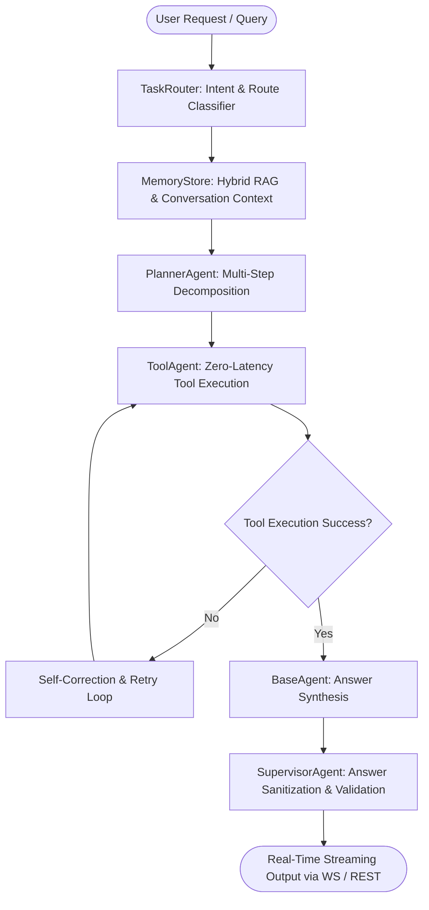

# 🏛️ Arsitektur Sistem JARVIS AI Agent v2.0

Dokumen ini mendokumentasikan desain teknis arsitektur 100% modular Python yang menggantikan sistem hybrid Node.js/Electron + LangChain terdahulu.

---

## 📐 Diagram Alir Pipeline (Agent Lifecycle)



---

## 📦 Struktur Paket Modular

```
Project-AI/
├── config/                  # Konfigurasi Pydantic v2 + PyYAML + Loguru
│   ├── agent_config.yaml    # Parameter perulangan & toleransi error
│   ├── model_config.yaml    # Parameter endpoint Ollama & embeddings
│   ├── logging_config.yaml  # Rotasi & format loguru
│   └── settings.py          # Unified Pydantic BaseSettings
├── data/
│   ├── raw/                 # Screenshots & unduhan sementara
│   ├── processed/           # Hasil laporan evaluasi benchmark
│   └── vector_db/           # Indeks TurboVec/FAISS + BM25Okapi + facts.json
├── src/
│   ├── agents/              # Core Agent modules
│   │   ├── base_agent.py    # Ollama async client & Pydantic output parser
│   │   ├── planner_agent.py # Pemecah instruksi majemuk (kata hubung ID)
│   │   ├── tool_agent.py    # Dynamic tool execution & recovery
│   │   └── supervisor_agent.py # Validasi format & pembersih label sintetis
│   ├── memory/              # Lapisan Memori
│   │   ├── short_term.py    # Multi-session sliding window & context chunker
│   │   ├── long_term.py     # Hybrid RAG (Dense Vector + BM25 + RRF)
│   │   └── memory_store.py  # Facade terpadu tanpa overhead HTTP
│   ├── prompts/             # Prompt engineering & Dynamic few-shot
│   ├── tools/               # 17 Konsolidasi Tools (Web, Code, API, Vision)
│   ├── workflows/           # Orchestrator & State Graph
│   │   ├── task_router.py   # Intent routing & live search rules
│   │   ├── agent_graph.py   # State graph lifecycle execution
│   │   └── orchestrator.py  # Main pipeline manager
│   ├── app/                 # Gateway & API
│   │   ├── api.py           # FastAPI REST & WebSocket /ws/chat
│   │   ├── ui.py            # Desktop & browser launcher
│   │   └── main.py          # Unified CLI entrypoint
│   └── gui/                 # Antarmuka Modern Web (Tailwind, Prism, Markdown)
│       └── api_adapter.js   # Browser polyfill untuk window.jarvis
├── scripts/                 # Runner & Utility Scripts
│   ├── build_index.py       # Codebase vector indexer
│   ├── evaluate.py          # Benchmark runner
│   ├── run_agent.ps1        # Windows launcher
│   └── run_agent.sh         # Linux launcher
└── tests/                   # Test Suites (Phases 1-6)
```

---

## ⚡ Fitur Utama & Keunggulan

1. **Zero-Latency In-Process RAG:** Menghilangkan server HTTP `local_memory.py:8000` lama. Indeks vektor `turbovec` (dengan fallback `faiss-cpu`) dan `BM25Okapi` diakses langsung di memori proses yang sama.
2. **Hybrid RAG dengan Reciprocal Rank Fusion (RRF):**
   $$RRF(d) = \sum_{m \in M} \frac{1}{60 + r_m(d)}$$
   Menggabungkan pencarian semantik (dense embeddings) dan pencarian leksikal (kata kunci BM25) secara optimal.
3. **Pydantic v2 Type-Safe Parsing:** Setiap pemanggilan tool (`ToolCall`) dan respons state divalidasi skemanya dengan Pydantic v2 tanpa risiko parsing error JSON liar.
4. **Independent GUI:** Antarmuka visual berjalan di browser modern atau PyWebView tanpa ketergantungan pada runtime Electron yang berat.
5. **Enkripsi Kredensial AES-256:** Kredensial sensitif disimpan terenkripsi dengan aman di `.jarvis-credentials.json`.
